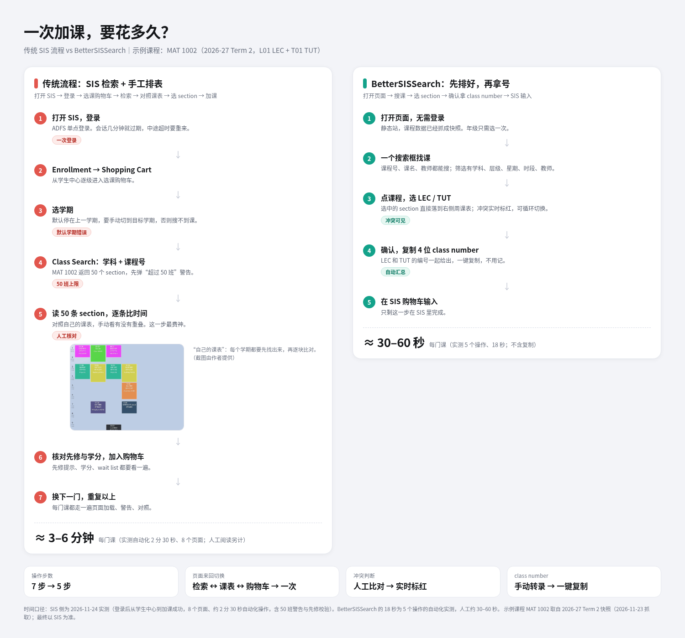
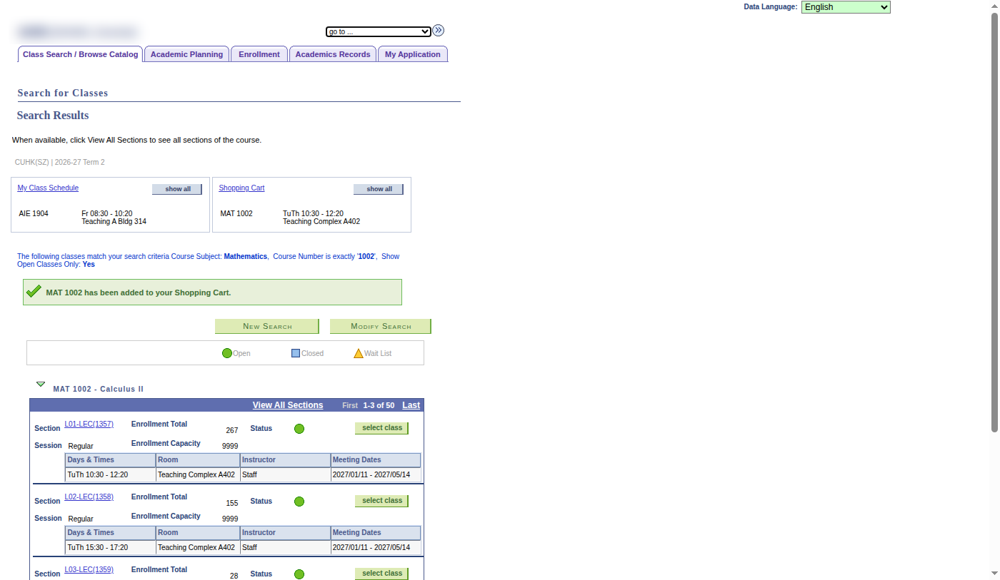
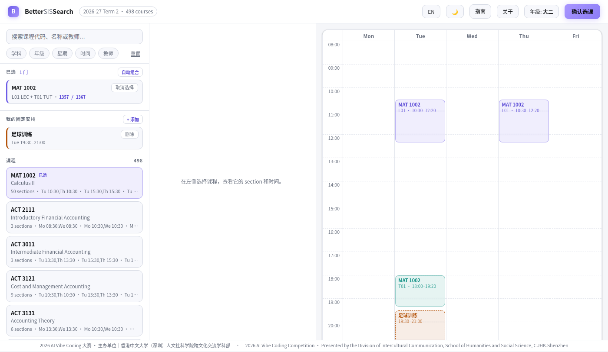
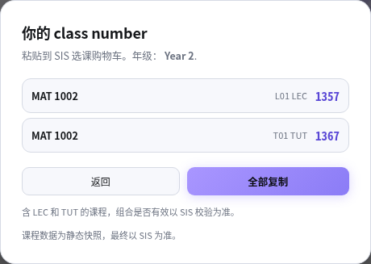
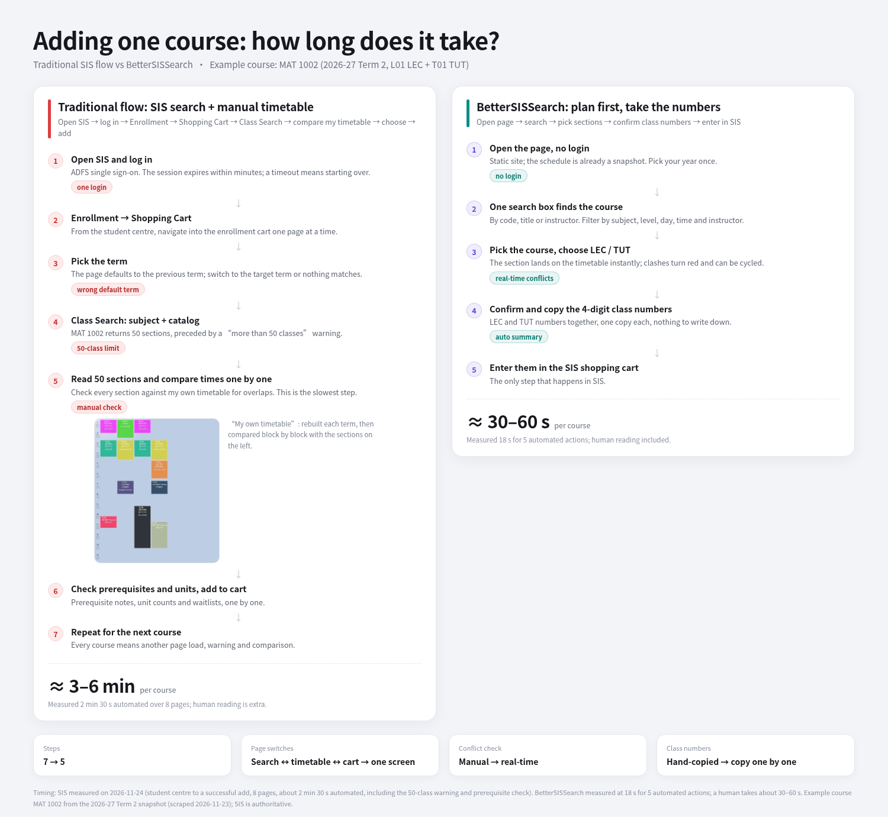
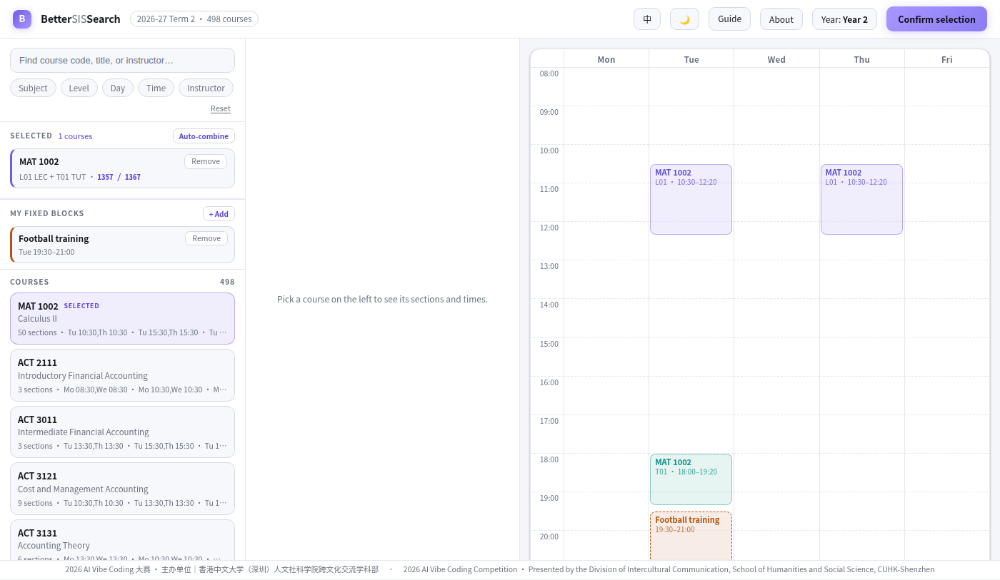
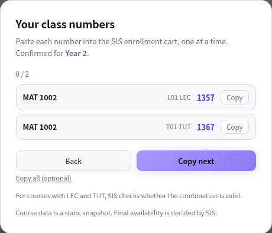

# BetterSISSearch

**2026 AI Vibe Coding 大赛参赛作品**
**Entry for the 2026 AI Vibe Coding Competition**

> 2026 AI Vibe Coding 大赛
> 主办单位｜香港中文大学（深圳）人文社科学院跨文化交流学科部
> 2026 AI Vibe Coding Competition
> Presented by the Division of Intercultural Communication
> School of Humanities and Social Science
> The Chinese University of Hong Kong, Shenzhen

个人参赛作品，不代表主办单位或学校的官方立场。
An individual entry. It does not represent the organiser or the University.

在线体验 / Live demo: https://josh-zhangccc.github.io/better-sissearch/
源码 / Source: https://github.com/Josh-Zhangccc/better-sissearch
反馈邮箱 / Contact: 125090969@link.cuhk.edu.cn

---

## 中文

### 一句话

BetterSISSearch 是一个面向 CUHK-SZ 学生的选课排表器。查课、排表、实时对齐冲突，最后给出可以直接在 SIS 里使用的 4 位 class number。

### 为谁解决什么问题

**目标用户**：CUHK-SZ 本科生，尤其是每学期预选、加退选阶段的学生。

**问题**：SIS 的课程检索只能查课，不能模拟一张时间表。学生要在检索结果、课程时间、自己的课表之间来回切换，手动比对冲突，最后还要回到 SIS 输入 class number。检索时每次都要重选年级。流程重复，容易出错。

**做法**：把课表数据一次性抓成静态快照，在浏览器里做可视化排课。选中课程后，课表立刻显示，冲突标红但允许保留。排不顺时可以点「自动组合」，让工具遍历已选课程的 section 找一组互不冲突的安排（可勾「不要早八」）；训练、兼职这类固定安排也能先占住时间，一起参与冲突判断。确认后输出每门 section 的 class number，复制到 SIS 购物车即可。

这里有一个容易被忽略的点。**课程编码**（3 个字母加 4 位数字，如 `MAT 3004`）只是课程标识；SIS 选课真正要输入的是 **class number**（4 位数字，每个 section 一个，如 `1692`）。知道 class number 就能在 SIS 里直接定位课程，省掉一次检索。BetterSISSearch 的价值，就是把“查课、排表、拿 class number”连成一条线。

### 为什么更快：两条流程对比

同一个加课目标（示例：MAT 1002，L01 LEC + T01 TUT），两条路径：

| 环节 | 传统 SIS | BetterSISSearch |
|---|---|---|
| 找课 | 选学期（默认停在上一学期）、学科、课程号；超过 50 个班先弹警告 | 一个搜索框，实时筛选 |
| 排时间 | 多个 section 逐条比对 | 选中后直接落到课表 |
| 查冲突 | 对照自己的周课表，人工看重叠 | 冲突实时标红，可在重叠区切换 |
| 输出 | 手动抄 class number | 一键汇总，复制 |
| 耗时 | 约 3–6 分钟/门（实测自动化 2 分 30 秒、8 个页面） | 约 30–60 秒/门（实测 5 个操作 18 秒） |

说明：传统流程中“对照自己的课表”这一步，用的是作者提供的周课表截图（见上图左侧）。SIS 侧为 2026-11-24 实测：登录后从学生中心到加课成功，共 8 个页面，示例课程 MAT 1002。

一位高年级同专业同学的实测：已知要上的课时，**10 分钟**排完（无早八、18 学分、留出周二晚足球训练）；同专业同学用传统方式约 **2 小时**，主要卡在时间查重。

### 怎么用

1. 打开页面。首次进入按提示选择年级。可以切换中英文和明暗主题。
2. 左侧搜索：课程编码、课名、教师。筛选：学科、层级、星期、时段、教师。
3. 点击课程，查看它的 section。实线是已排入课表的 section，虚线是其他可选 section。时间重叠会标红。
4. 在重叠区域重复点击，可以在几个冲突 section 之间循环切换。点击空白处取消选中。
5. 点「自动组合」：工具遍历已选课程的 section，给出一组互不冲突的安排；勾选「不要早八」会排除 09:00 前开始的时间。结果直接落到课表，旁边有「撤销」。
6. 有固定安排（如周二晚足球训练）时，点「我的固定安排 → + 添加」占用一段时间；它会显示在课表里，并参与冲突判断和自动组合。
7. 确认选择。每个 class number 都能单独复制，按 SIS 的顺序逐个粘贴到 Enrollment Shopping Cart 的 Enter Class Nbr。
8. 教程（含截图）：`tutorial.html`

无需登录。不写 SIS。不修改任何课程数据。

### 数据与边界

- 数据源：SIS Class Search，2026-27 Term 2（strm 2620）公开课表快照。
- 抓取日：2026-11-23。498 门课，1574 个 section，覆盖 53 个 subject。
- 补充：AIE1902 / AIE1904 是学院专属探索课，SIS 中教师显示为 `Staff`；19 个 section 的授课时间与教师于 2026-11-27/28 取自 SAI 人工智能学院官方课程页（`apply_sai.py` + `data/sai_aie*_spring2027.json`，含每个 section 的主题）。
- 快照只包含抓取时 open 的班级。容量、名额、课程变动以 SIS 为准。
- 运行时不需要 SIS，也不需要登录。全部数据随站点静态分发。
- 已知局限：不提供容量信息；一节 lec 与多节 tut 的绑定关系不完整，可以先用 tut 的 class number 在 SIS 里反查 lec；部分课程有学院/年级限制（如 AIE 探索课），站点不校验选课资格，以 SIS 为准。

### 隐私

- 不需要账号。不收集姓名、学号、邮箱。
- 选课状态只保存在浏览器本地（localStorage）。
- 如启用匿名访问计数：只记录当日哈希标记，每日加盐，IP 和 User-Agent 不落盘，无法跨日关联，也无法识别个人。
- 提交版可以关闭计数。

### AI 工具与分工

- **AI 工具**：DeepSeek Harness（dsh）Web 对话，模型 `deepseek-flash`，含 1 个数据抓取子代理。
- **浏览器自动化**：ego，用于自测交互与截图（约 128 次截图调用）。
- **人工部分**：需求定义、交互决策、文案审核、数据核验、部署判断。
- **过程明细**：`AI_COLLABORATION_LOG.md`（6 轮迭代 + 3 篇补记：11-24、11-28 数据、11-28 功能）。

### 用户反馈与改进

**关键发现（2026-11-24 收集，2 位用户）**：一位高年级理工科同学最看重**可视化排表与冲突实时对齐**，class number 只是顺带简化检索；一位低年级心理学同学在简单体验后指出 class number 在 SIS 只能逐条输入，于是把“全部复制”改成逐条复制。

**一位高年级同专业同学（室友）的实测**：他已知自己要上哪些课，约束是“没有早八、18 学分、留出周二晚上的足球训练”。用 BetterSISSearch **10 分钟**排好；同专业同学用传统方式（SIS 检索 + 手工比对）大约花 **2 小时**，主要卡在时间查重，不得不用平板 + 手写笔记录各门课的时间信息来找组合。之后他用 20–30 分钟做学习计划，并用本工具找到了可以加课的时间段。

| 用户 | 使用场景 | 反馈 | 对应的改进 | 证据 |
|---|---|---|---|---|
| U1（高年级理工科，同专业，2026-11-24） | 完整选课流程：18 学分；无早八；留出周二晚足球训练 | 10 分钟排完；同学用 SIS 约 2 小时，卡在时间查重 | 已做：自动组合（可选不要早八）+ 个人固定安排，冲突实时对齐 | 应用内功能；见「怎么用」第 5、6 步与 `AI_COLLABORATION_LOG.md` |
| U2（低年级心理学，2026-11-24） | 简单体验后给出流程建议 | class number 只能逐条输入；“全部复制”用不上，实际是复制一个、去 SIS 粘贴、再下一个 | 已做：每行单独复制 + “复制下一个”进度（0/2 → 2/2），全部复制降为备用 | 截图见 `assets/fig-confirm.png`；线上版已更新 |

**根据反馈计划改进**（提交前完成并补到上表）：

- ✅ 逐条复制 class number：每行独立复制 + “复制下一个”进度，全部复制降为备用（已完成，见 U2）；
- ✅ 自动找“不冲突的 section 组合”，可选“不要早八”（已完成，见 U1）；
- ✅ 支持个人固定安排（如周二晚足球训练），参与冲突判断（已完成，见 U1）；
- 显示空闲时段：评估后暂不做（优先用自动组合解决“找时间加课”，避免界面再堆信息）。

说明：反馈来自本学期选课期的真实使用。不公开用户身份。改进会同步到本仓库的提交记录与截图。

### 局限与下一步

- 数据快照会过期。下一步加一键更新脚本，并在页面上显示数据日期。
- 容量信息需要额外数据源，本期不做。
- lec / tut 绑定关系可以补全。
- 只支持 2026-27 Term 2。下学期复用需要重新抓取。

---

## English

### One line

BetterSISSearch is a course planning simulator for CUHK-SZ students. Search courses, build a timetable, align conflicts in real time, and get the 4-digit class numbers ready for SIS.

### Who it is for and what it solves

**Target users**: CUHK-SZ undergraduates, especially during pre-enrollment and add/drop.

**Problem**: SIS course search finds courses but cannot simulate a timetable. Students switch between search results, meeting times and their own schedule, check conflicts by hand, then type class numbers back into SIS. The search flow also asks for the year every time. It is repetitive and error-prone.

**Approach**: scrape the class schedule once into a static snapshot, then plan visually in the browser. Selected sections appear on the timetable at once. Conflicts are marked red but allowed. When a plan gets stuck, **Auto-combine** searches the selected courses for a clash-free set of sections (with an optional no-morning rule), and personal fixed blocks such as training or a part-time job can hold time and take part in the check. Confirmation outputs each section's class number for the SIS shopping cart.

One point is easy to miss. A **course code** (three letters plus four digits, e.g. `MAT 3004`) is only the catalog identifier. What SIS actually enrolls by is the **class number** (four digits, one per section, e.g. `1692`). With the class number you can locate a course in SIS directly, without searching again. BetterSISSearch connects the three steps: search, plan, and class numbers.

### Why it is faster: two workflows

Same goal (example: MAT 1002, L01 LEC + T01 TUT), two paths:

| Step | Traditional SIS | BetterSISSearch |
|---|---|---|
| Find the course | Pick term (defaults to the previous term), subject and catalog; a “more than 50 classes” warning appears first | One search box, live filtering |
| Build the week | Compare sections one by one | Selected sections land on the timetable |
| Check conflicts | Compare against your own weekly schedule by hand | Conflicts turn red in real time; click to cycle |
| Get class numbers | Copy them by hand | Collected and copied in one go |
| Time | about 3–6 minutes per course (2 min 30 s automated, 8 pages) | about 30–60 seconds per course (5 actions, 18 seconds measured) |

Note: the “own timetable” step in the traditional flow uses the author's weekly schedule screenshot (left side of the diagram). The SIS side was measured on 2026-11-24: from the student centre to a successful add, 8 pages, with MAT 1002 as the example.

A senior classmate's test: with the courses already known, **10 minutes** to build a timetable (no 8 a.m., 18 credits, Tuesday evening football kept free). Classmates using SIS took about **2 hours**, mostly on conflict checking.

### How to use

1. Open the page. Pick your year on the first visit. Switch language and theme if needed.
2. Search on the left: course code, title, instructor. Filter by subject, level, weekday, time and instructor.
3. Click a course to see its sections. Solid blocks are scheduled sections. Dashed blocks are alternatives. Overlaps turn red.
4. Click an overlapping area again to cycle through conflicting sections. Click empty space to clear the selection.
5. Click **Auto-combine**: it walks the sections of the selected courses and returns a clash-free set; the no-morning option drops anything starting before 09:00. The result lands on the timetable, with an Undo next to it.
6. For a standing commitment (Tuesday football, a part-time job), use **My fixed blocks → + Add**; the block shows on the timetable and takes part in conflict checks and Auto-combine.
7. Confirm. Copy each class number separately, then enter them one by one in the SIS Enrollment Shopping Cart (Enter Class Nbr).
8. Tutorial with screenshots: `tutorial.html`

No login. Nothing is written to SIS. No course data is modified.

### Data and boundaries

- Source: SIS Class Search, 2026-27 Term 2 (strm 2620), a public schedule snapshot.
- Scraped on 2026-11-23. 498 courses, 1574 sections, 53 subjects.
- Supplement: AIE1902 / AIE1904 are college-run exploration courses that SIS lists with instructor `Staff`; the 19 sections' times and lecturers were added on 2026-11-27/28 from the SAI official course pages (`apply_sai.py` + `data/sai_aie*_spring2027.json`, including each section's topic).
- The snapshot includes open classes only. Seats and live changes remain authoritative in SIS.
- Static data. No SIS access at runtime, no login.
- Known limits: no seat capacity; lecture/tutorial bindings are incomplete (use a tutorial class number in SIS to find its lecture); some courses are restricted to a college or year (e.g. the AIE exploration courses) — eligibility is not checked here, SIS decides.

### Privacy

- No account. No name, student ID or email is collected.
- Selections stay in your browser (localStorage).
- Optional anonymous visit count: a daily hashed marker with a per-day salt. IP and User-Agent are never written to disk. Keys cannot be linked across days or to a person.
- Counting can be disabled in the submitted build.

### AI tools and division of work

- **AI tool**: DeepSeek Harness (dsh) web session, model `deepseek-flash`, plus one scraping subagent.
- **Browser automation**: ego for interaction self-testing and screenshots (~128 screenshots).
- **Human work**: requirements, interaction decisions, copy review, data verification, deployment decisions.
- **Details**: `AI_COLLABORATION_LOG.md` (6 rounds plus three follow-up notes: 11-24, the 11-28 data note, and the 11-28 feature note).

### User feedback and improvements

**Key finding (collected 2026-11-24, 2 users)**: a senior STEM student valued the **visual timetable and real-time conflict alignment** most; the class number only simplified the search step. A lower-year psychology student, after a brief trial, pointed out that SIS takes class numbers one at a time, so “copy all” was replaced with one-by-one copying.

**A senior classmate's test**: knowing which courses to take, with the constraints “no 8 a.m. classes, 18 credits, keep Tuesday evening for football training”, he built his timetable in **10 minutes** with BetterSISSearch. Classmates using SIS took about **2 hours**, mostly stuck on conflict checking, and had to use a tablet plus stylus to record course times while searching for combinations. He then spent 20–30 minutes on his study plan and used the tool to find slots for extra courses.

| User | Context | Feedback | Change made | Evidence |
|---|---|---|---|---|
| U1 (senior STEM, same major, 2026-11-24) | Full enrolment flow: 18 credits; no 8 a.m.; Tuesday evening football | 10 minutes vs ~2 hours for peers; conflict checking was the blocker | Done: Auto-combine (no-morning option) + fixed personal blocks, conflicts aligned live | In-app feature; see How to use steps 5–6 and `AI_COLLABORATION_LOG.md` |
| U2 (lower-year psychology student, 2026-11-24) | Brief trial, then a workflow suggestion | Class numbers are entered one by one in SIS; “Copy all” is not usable; the real flow is copy one, paste in SIS, then the next | Done: per-row copy button + “Copy next” progress (0/2 → 2/2); copy-all kept as optional | Screenshot: `assets/fig-confirm.png`; live site updated |

**Planned improvements from this feedback** (to be finished and added to the table before submission):

- ✅ One-by-one class number copying: per-row copy button + “Copy next” progress; copy-all kept as optional (done, see U2);
- ✅ Automatic conflict-free section combinations, with a “no 8 a.m.” option (done, see U1);
- ✅ Fixed personal blocks (e.g. Tuesday evening football) in conflict checking (done, see U1);
- Free-slot display: deliberately not built (Auto-combine already answers “when can I add a course” without piling more UI on).

Notes: feedback comes from real use during this term's enrolment period. User identities are not published. Improvements will be tracked in the repository history and screenshots.

### Limitations and next steps

- The snapshot expires. Next: a one-click refresh, and a visible data date on the page.
- Seat capacity needs another data source. Out of scope for now.
- Complete the lecture/tutorial mapping.
- Only 2026-27 Term 2 is supported. Re-scrape for the next term.

---

### 统一署名 / Required attribution

署名位置：本 README 文首；作品页面**页脚**（每页可见）与右上角「关于 / About」弹窗（含数据快照日期与联系方式）。
Attribution locations: the top of this README; the page footer (always visible) and the About dialog in the app (with data snapshot date and contact).

2026 AI Vibe Coding 大赛
主办单位｜香港中文大学（深圳）人文社科学院跨文化交流学科部
2026 AI Vibe Coding Competition
Presented by the Division of Intercultural Communication
School of Humanities and Social Science
The Chinese University of Hong Kong, Shenzhen
